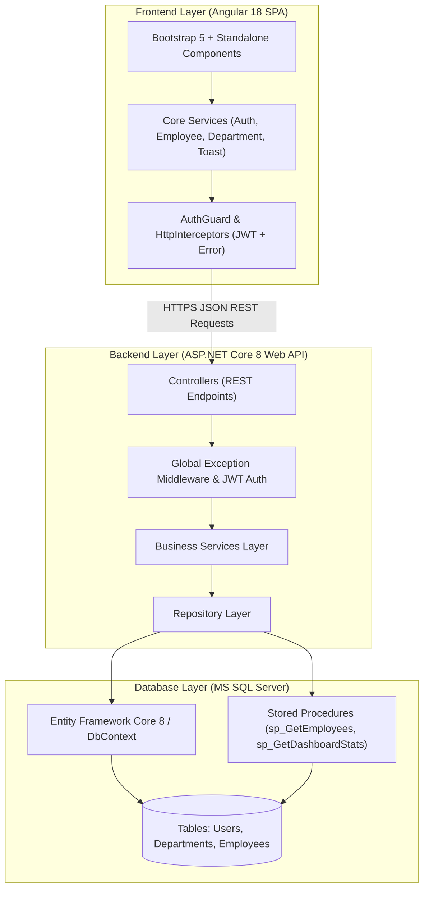

# Employee Management System (StaffHub Enterprise)

> **A Complete Full-Stack Professional Internship & Enterprise Project**  
> Built with **Angular 18**, **ASP.NET Core 8 Web API**, **Entity Framework Core**, and **Microsoft SQL Server**.

---

## 📌 1. Project Overview

The **Employee Management System** (**StaffHub**) is an enterprise web solution engineered to digitize human capital management, department allocations, compensation analytics, and workforce onboarding.

Designed as a modern full-stack web application, it enforces clean architecture, separation of concerns, secure JWT authentication, stored procedure execution, and responsive UX design.

---

## 🚀 2. Technology Stack

| Tier | Technologies |
| :--- | :--- |
| **Frontend** | Angular 18 (Standalone Components, Signals, Reactive Forms), TypeScript, Bootstrap 5.3, Bootstrap Icons, Chart.js |
| **Backend API** | C# .NET 8.0, ASP.NET Core Web API, Entity Framework Core 8, LINQ, DTOs, Repository & Service Patterns |
| **Database** | Microsoft SQL Server (2019/2022/LocalDB/Azure SQL), T-SQL Stored Procedures, Foreign Keys & Indexes |
| **Security & Auth**| JWT (JSON Web Tokens), SHA-256 / PBKDF2 Password Hashing, CORS Configuration, Global Exception Middleware |
| **Tooling & API Docs** | Swagger / OpenAPI 3.0, Git / GitHub |

---

## 🏛️ 3. Architecture Overview



---

## 📁 4. Project Directory Structure

```text
EmployeeManagementSystem/
│
├── database/                                # SQL Server Database Scripts
│   ├── 01_Create_Database_And_Tables.sql    # Schema, Constraints, Foreign Keys & Indexes
│   ├── 02_Stored_Procedures.sql             # sp_GetEmployees, sp_GetEmployeeById, sp_GetDashboardStats
│   └── 03_Seed_Data.sql                     # Realistic Admin, Departments and Employees seed records
│
├── backend/                                 # ASP.NET Core 8 Web API Solution
│   └── EmployeeManagement.API/
│       ├── Controllers/                     # REST API Controllers (Auth, Employees, Departments, Dashboard)
│       │   ├── AuthController.cs
│       │   ├── EmployeesController.cs
│       │   ├── DepartmentsController.cs
│       │   └── DashboardController.cs
│       ├── Models/                          # EF Core Data Entities
│       │   ├── User.cs
│       │   ├── Department.cs
│       │   └── Employee.cs
│       ├── DTOs/                            # Data Transfer Objects & ApiResponse Wrapper
│       │   ├── ApiResponse.cs
│       │   ├── AuthDtos.cs
│       │   ├── EmployeeDtos.cs
│       │   ├── DepartmentDtos.cs
│       │   └── DashboardDtos.cs
│       ├── Data/                            # DbContext & Automatic DB Seeder
│       │   ├── AppDbContext.cs
│       │   └── DbInitializer.cs
│       ├── Repositories/                    # Repository Pattern & Stored Procedure Execution
│       │   ├── IEmployeeRepository.cs
│       │   ├── EmployeeRepository.cs
│       │   ├── IDepartmentRepository.cs
│       │   └── DepartmentRepository.cs
│       ├── Services/                        # Business Logic Layer
│       │   ├── IAuthService.cs & AuthService.cs
│       │   ├── IEmployeeService.cs & EmployeeService.cs
│       │   ├── IDepartmentService.cs & DepartmentService.cs
│       │   └── IDashboardService.cs & DashboardService.cs
│       ├── Middleware/                      # Global Custom Exception Handling
│       │   └── ExceptionMiddleware.cs
│       ├── Program.cs                       # DI, Middleware Pipeline, Swagger & CORS Config
│       ├── appsettings.json                 # Connection Strings & JWT Settings
│       └── EmployeeManagement.API.csproj
│
└── frontend/                                # Angular 18 Single Page Application
    ├── src/
    │   ├── app/
    │   │   ├── core/                        # Guards, Interceptors & Services
    │   │   │   ├── guards/auth.guard.ts
    │   │   │   ├── interceptors/jwt.interceptor.ts
    │   │   │   ├── interceptors/error.interceptor.ts
    │   │   │   └── services/ (auth, employee, department, dashboard, toast)
    │   │   ├── models/                      # TypeScript Interfaces
    │   │   ├── components/                  # Navbar, Sidebar, Toast, ConfirmModal
    │   │   └── pages/                       # Login, Dashboard, EmployeeList, Form, Details, Depts
    │   │       ├── login/
    │   │       ├── dashboard/
    │   │       ├── employee-list/
    │   │       ├── employee-form/
    │   │       ├── employee-details/
    │   │       ├── department-list/
    │   │       └── not-found/
    │   ├── environments/                    # API Endpoints Config
    │   ├── styles.css                       # Modern Dashboard Styling System
    │   └── index.html                       # Fonts, Bootstrap & Chart.js imports
    ├── package.json
    └── angular.json
```

---

## ⚙️ 5. Step-by-Step Setup & Execution

### 🗄️ Step A: Database Setup (Microsoft SQL Server)
1. Open **SQL Server Management Studio (SSMS)** or **Azure Data Studio**.
2. Connect to your local SQL Server instance (e.g., `localhost` or `.\SQLEXPRESS`).
3. Execute the SQL scripts in chronological order from the `database/` folder:
   - `01_Create_Database_And_Tables.sql`
   - `02_Stored_Procedures.sql`
   - `03_Seed_Data.sql`

*(Note: The ASP.NET Core backend also features automatic DB creation and seeding via `DbInitializer.cs` upon initial startup if the database does not yet exist).*

---

### 🖥️ Step B: Backend Web API Setup (.NET 8)
1. Open terminal inside `backend/EmployeeManagement.API/`:
   ```bash
   cd backend/EmployeeManagement.API
   ```
2. Verify your connection string in `appsettings.json`:
   ```json
   "ConnectionStrings": {
     "DefaultConnection": "Server=localhost;Database=EmployeeManagementDB;Trusted_Connection=True;TrustServerCertificate=True;MultipleActiveResultSets=true;"
   }
   ```
3. Restore packages and run the API:
   ```bash
   dotnet restore
   dotnet run
   ```
4. Access the interactive **Swagger UI** in your browser at:
   👉 **`https://localhost:7198/swagger`** or **`http://localhost:5000/swagger`**

---

### 🌐 Step C: Frontend Setup (Angular 18)
1. Open a new terminal inside `frontend/`:
   ```bash
   cd frontend
   ```
2. Install node dependencies:
   ```bash
   npm install
   ```
3. Start the Angular dev server:
   ```bash
   npm start
   # or: ng serve --open
   ```
4. Open your browser at **`http://localhost:4200`**.

---

## 🔑 6. Default Login Credentials

| Username / Email | Password | Role | Permissions |
| :--- | :--- | :--- | :--- |
| `admin` or `admin@company.com` | `Admin@123` | **Admin** | Full access to Employees, Departments & Metrics |
| `hr_manager` or `hr@company.com` | `Admin@123` | **HR** | Full HR CRUD & Management capabilities |

*(Quick demo login buttons are provided directly on the Login page for seamless evaluation).*

---

## 📡 7. REST API Endpoints Reference

### 🔐 Authentication (`/api/auth`)
- `POST /api/auth/login` - Authenticate user & return JWT token
- `POST /api/auth/register` - Create new admin/user account

### 👥 Employees (`/api/employees`)
- `GET /api/employees` - Search, filter by department/status, sort, and paginate employees
- `GET /api/employees/{id}` - Retrieve single employee details by ID
- `GET /api/employees/department/{deptId}` - Retrieve all employees in a specific department
- `POST /api/employees` - Register a new employee (validates email uniqueness, age & department)
- `PUT /api/employees/{id}` - Update employee records
- `DELETE /api/employees/{id}` - Permanently delete an employee

### 🏢 Departments (`/api/departments`)
- `GET /api/departments` - List all departments with active employee counts
- `GET /api/departments/{id}` - Get department details
- `POST /api/departments` - Create a new department
- `PUT /api/departments/{id}` - Edit department information
- `DELETE /api/departments/{id}` - Delete department (enforces referential integrity check)

### 📊 Dashboard Analytics (`/api/dashboard`)
- `GET /api/dashboard/stats` - Total staff, active/inactive counts, payroll total, average salary, department distribution percentages & recent hires

---

## 🛡️ 8. Key Features & Validation Rules

1. **Robust Validation**:
   - **Full Name**: 2–100 characters.
   - **Email**: Standard RFC format, strictly unique in database.
   - **Phone Number**: International/standard phone regex validation.
   - **Age Constraint**: Enforces minimum 18 years of age calculated against `DateOfBirth`.
   - **Salary**: Numerical positive values above $1,000.
   - **Department Safety**: Deletion is blocked if active employees are currently assigned to the department.
2. **Dual-Query Flexibility (EF Core & Stored Procedures)**:
   - Includes a live toggle in the UI and repository to switch between LINQ queries and SQL Server Stored Procedure `sp_GetEmployees`.
3. **UX & Responsive Design**:
   - Modern indigo/slate color scheme, interactive toast notifications, modal deletion confirmations, search debounce, and full mobile/tablet responsiveness.

---

## 🎓 9. Internship Viva & Presentation Highlights

When demonstrating this project to examiners or technical interviewers:
1. **Explain the 3-Tier Layered Architecture**: Show how `Controllers` delegate to `Services` (business rules), which call `Repositories` (data access), keeping code clean and testable.
2. **Highlight Stored Procedure Integration**: Point out `database/02_Stored_Procedures.sql` and `EmployeeRepository.cs` where parameterized SQL execution prevents SQL injection and boosts performance.
3. **Discuss Security**: Point out JWT generation in `AuthService.cs`, password hashing, and the Angular `JwtInterceptor` that automatically injects tokens into outgoing HTTP requests.
4. **Demonstrate Global Error Handling**: Show how `ExceptionMiddleware.cs` intercepts all unexpected crashes and formats uniform JSON error responses with proper HTTP status codes (200, 201, 400, 401, 404, 500).
